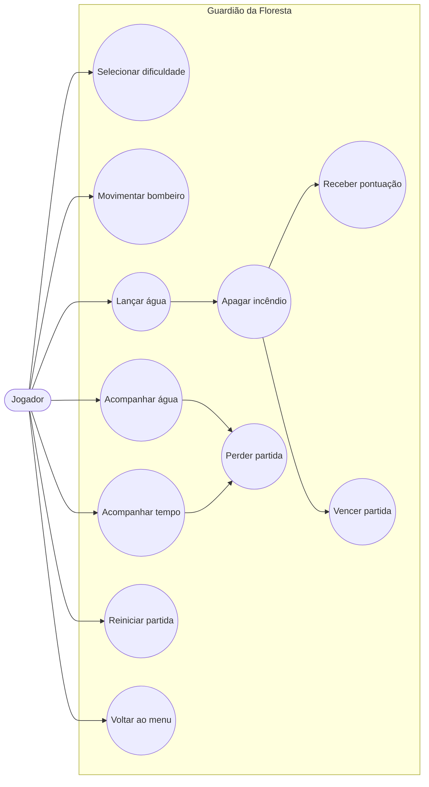
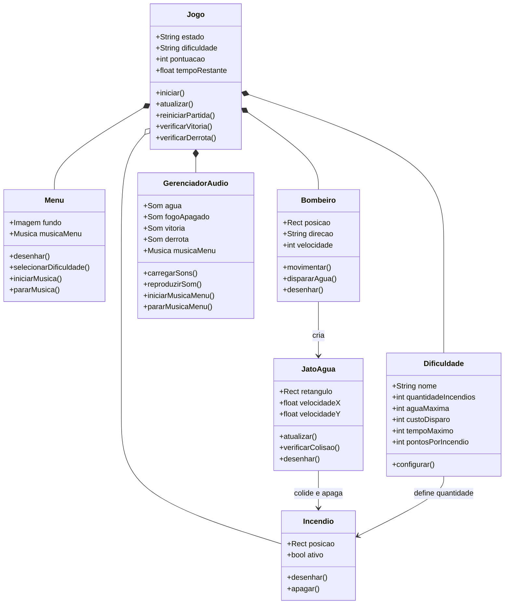
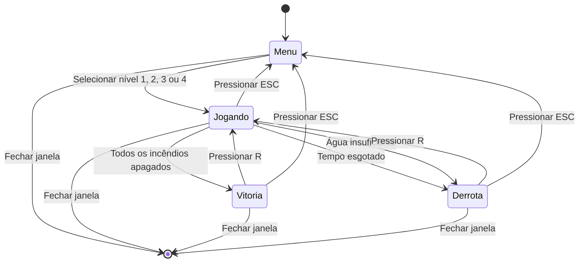
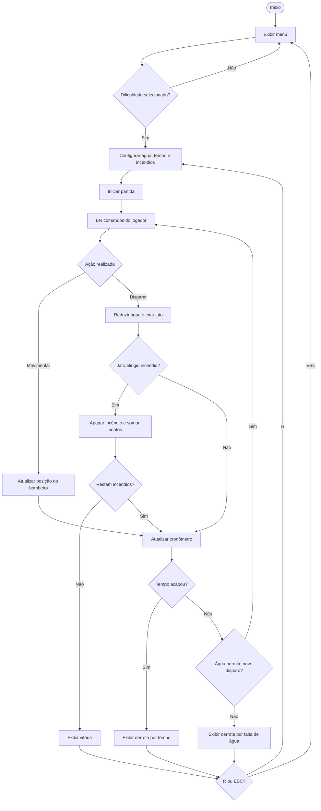

# 🌲🔥 Guardião da Floresta


## 📖 Sobre o projeto

**Guardião da Floresta** é um jogo 2D desenvolvido em **Python** com a biblioteca **Pygame**. O jogador controla um bombeiro florestal e precisa apagar todos os focos de incêndio antes que o tempo ou a água acabem.

O projeto foi desenvolvido com foco em lógica de programação, eventos de teclado, colisões, gerenciamento de estados, níveis de dificuldade, cronômetro, pontuação, imagens e efeitos sonoros.

## 🎯 Objetivo do jogo

Apague todos os focos de incêndio antes que uma das condições de derrota aconteça:

- o cronômetro chegar a `00:00`;
- a quantidade de água ficar abaixo do custo de um novo disparo;
- ainda existirem incêndios no cenário.

## ✨ Funcionalidades

- Menu inicial com imagem de fundo e elementos transparentes;
- Música exclusiva no menu;
- Quatro níveis de dificuldade;
- Movimentação em quatro direções e na diagonal;
- Sistema de disparo de água;
- Detecção de colisão entre água e incêndios;
- Barra de água dinâmica;
- Cronômetro regressivo;
- Sistema de pontuação;
- Condições de vitória e derrota;
- Efeitos sonoros de água, incêndio apagado, vitória e derrota;
- Incêndio especial no telhado da cabana no nível extremo;
- Reinício da partida e retorno ao menu;
- Executável para Windows gerado com PyInstaller.

## 🎮 Controles

| Tecla | Ação |
|---|---|
| `W` ou `↑` | Movimentar para cima |
| `S` ou `↓` | Movimentar para baixo |
| `A` ou `←` | Movimentar para a esquerda |
| `D` ou `→` | Movimentar para a direita |
| `ESPAÇO` | Lançar água |
| `R` | Reiniciar após vitória ou derrota |
| `ESC` | Voltar ao menu |
| `1`, `2`, `3`, `4` | Selecionar a dificuldade |

## 🧩 Níveis de dificuldade

| Nível | Incêndios | Água | Custo por disparo | Tempo | Pontos por incêndio |
|---|---:|---:|---:|---:|---:|
| Fácil | 3 | 100% | 2% | 02:00 | 100 |
| Médio | 4 | 80% | 3% | 01:30 | 200 |
| Difícil | 6 | 60% | 4% | 01:00 | 300 |
| Extremo | 9 | 50% | 5% | 00:45 | 500 |

> O nível **Extremo** possui um foco de incêndio especial no telhado da cabana.

## 🛠️ Tecnologias utilizadas

- Python 3;
- Pygame;
- pathlib;
- PyInstaller;
- Mermaid para os diagramas UML.

## 📁 Estrutura do projeto

```text
Guardiao_da_Floresta/
├── assets/
│   ├── imagens/
│   │   └── menu.png
│   └── sons/
│       ├── agua.wav
│       ├── fogo_apagado.wav
│       ├── vitoria.wav
│       ├── derrota.wav
│       └── musica_menu.mp3
├── executavel/
│   └── Guardiao_da_Floresta.exe
├── prints/
├── main.py
└── README.md
```

# 📐 Diagramas UML

## 1. Diagrama de casos de uso



## 2. Diagrama de classes



## 3. Diagrama de estados



## 4. Diagrama de atividade da partida



## ▶️ Como executar pelo código-fonte

### 1. Clone o repositório

```bash
git clone URL_DO_SEU_REPOSITORIO
cd Guardiao_da_Floresta
```

### 2. Instale o Pygame

```bash
python -m pip install pygame
```

### 3. Execute o jogo

```bash
python main.py
```

## 💻 Como executar no Windows

Abra a pasta `executavel` e execute:

```text
Guardiao_da_Floresta.exe
```

## 📦 Como gerar o executável

Instale o PyInstaller:

```powershell
python -m pip install --upgrade pyinstaller
```

Gere o executável incluindo a pasta `assets`:

```powershell
python -m PyInstaller --noconfirm --clean --onefile --windowed --name "Guardiao_da_Floresta" --add-data "assets;assets" main.py
```

O executável será criado em:

```text
dist/Guardiao_da_Floresta.exe
```

## 🖼️ Capturas de tela

Adicione as imagens da pasta `prints` nesta seção. Exemplo:

```markdown


```

## 👨‍💻 Autor

**Jean Carlos Kovaliki**  
Estudante de Engenharia de Software

## 📄 Licença

Projeto desenvolvido para fins acadêmicos e educacionais.
